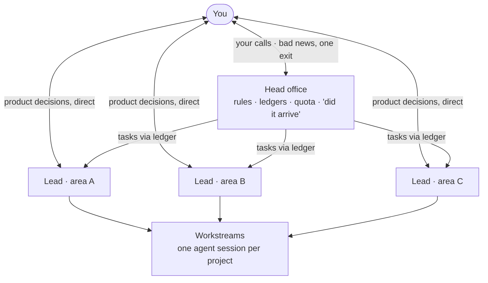

# One-Person AI Company

**English** · [中文](README.zh-CN.md)

**How I run a company alone with 30+ AI agents, written up so you can copy it.** An org chart with clear lines of communication, a task ledger, handoff records, delivery reconciliation, a definition of done, quota budgets, and rules that machines actually enforce. Ships as templates, four small checks, and an agent skill that sets it all up for you.

[](https://github.com/Balance0014/one-person-ai-company/actions/workflows/ci.yml)   

---

## Why this exists

Running one agent is easy. Running thirty is a management problem. Every piece here exists because one of these actually happened to us:

- An agent reported "done" because it found no errors. Nothing had shipped.
- The account hit its weekly limit mid-task, and everything the agent knew vanished with the chat.
- Development work burned the whole week's quota, and the scheduled reports people were waiting for stopped for four days.
- The alarm that should have reported the outage ran on the same thing that was down.
- The same rule was copied into a scheduled job's prompt and into the repo. The copies drifted apart.
- An alert fired every day until nobody read it, including the day it mattered.

## How it is organized



Head office talks only to leads; leads run their own workstreams; anything crossing two areas goes through head office. You hear bad news through one exit, discuss product decisions directly with the lead who owns them, and are asked only about money, irreversible deletions, rules you set, and anything going public. [Chapter 1](playbook/01-org-chart.md) has the full rules.

## What's inside

| Chapter | Fixes | Comes with |
|---|---|---|
| [1 · Org chart and lines of communication](playbook/01-org-chart.md) | Everyone reports to you; rules copied everywhere; messages for everything | Role card template |
| [2 · The dispatch ledger](playbook/02-dispatch-ledger.md) | Tasks lost in chat | `scripts/dispatch.py` |
| [3 · Handoff records](playbook/03-handoff-records.md) | Account or quota dies, context dies with it | `scripts/handoff_check.py` |
| [4 · One judge per question](playbook/04-one-judge-per-question.md) | Agents grading their own homework | `scripts/reconcile.py` |
| [5 · The definition of done](playbook/05-definition-of-done.md) | "Fixed" meaning "worked once" | Enforced by `dispatch.py done` |
| [6 · Quota budgets](playbook/06-quota-budget.md) | Building starves the jobs that matter | Budget template |
| [7 · Rules become gates](playbook/07-rules-become-gates.md) | Rules that quietly stop being enforced | `scripts/rules_check.py` |
| [8 · Alerts that remember](playbook/08-alerts-that-remember.md) | Alert fatigue; alerts that say what but not what to do | Three-question checklist |

## Our numbers

This is not a thought experiment. As of 28 October 2026, in our own setup:

| | |
|---|---|
| Agents | 18 active long-running sessions (one per lead or project) plus about 20 scheduled agents |
| Structure | Head office, 4 leads, 45 role cards |
| Scheduled deliveries reconciled | 21 daily and weekly ones, checked twice a day by a reconciler on a small server with zero model calls |
| Rules | 170 registered: 82 machine-enforced (48%), 41 checked on a schedule (24%), 47 still on discipline (28%) |
| Dispatch ledger | 67 tasks since mid-September: 33 closed with five-item evidence, 8 rejected, 26 open |
| Handoff records | 24; drilled on 15 by opening fresh sessions with no chat history |

The worst week is in the playbook too: an 18-day outage that the reconciler reported correctly every morning and that still was not fixed sooner ([chapter 4](playbook/04-one-judge-per-question.md#what-it-looked-like-for-us)).

## See it in 30 seconds

No install needed. Python 3.9+ and the standard library only.

```bash
git clone https://github.com/Balance0014/one-person-ai-company
cd one-person-ai-company/examples
python3 ../scripts/reconcile.py --date 2026-10-27
python3 ../scripts/handoff_check.py
python3 ../scripts/rules_check.py
```

```
| | Delivery | Due | Result |
|---|---|---|---|
| ❌ | Morning brief | 2026-10-27 09:00 | missing, nothing by 09:40 |

✓ content.md
✗ research.md
    - missing section "## In progress"
    ...
✗ R-06: enforcer scripts/link_gate.py does not exist — Posts with broken links never ship
```

The example data is built to fail in instructive ways.

## Use it in your own repo

**As an agent skill** (Claude Code and other agents that read `SKILL.md`):

```bash
npx skills add https://github.com/Balance0014/one-person-ai-company
```

Then ask your agent: *"Set up the one-person AI company structure in this repo."* It copies the templates, asks who your leads are, writes role cards and handoff records, and runs the four checks. CI installs the skill this way on every push.

**By hand:**

```bash
cp -r templates/ops templates/ops.config.json /path/to/your/repo/
cp -r scripts /path/to/your/repo/
```

Then run the health check from your repo root:

```bash
python3 scripts/dispatch.py overdue
python3 scripts/handoff_check.py --repo .
python3 scripts/reconcile.py
python3 scripts/rules_check.py
```

Each exits 1 when something needs attention, so they drop straight into a hook, a cron job, or CI.

## The four checks

| Script | Answers | Model calls |
|---|---|---|
| `dispatch.py` | What's open, who owns it, what's late? Refuses to close a task without the five-item definition of done | 0 |
| `handoff_check.py` | Could a fresh session pick up each workstream right now? | 0 |
| `reconcile.py` | Did every scheduled delivery actually arrive, on time? | 0 |
| `rules_check.py` | Is every enforced rule still enforced by something that exists? | 0 |

All paths come from `ops.config.json`. Nothing is hard-coded. Tests cover both directions (good input passes, bad input is caught): `python3 -m unittest discover tests`.

## Known limits

- **These scripts are a clean rewrite**, not our production code, which is tied to our own servers and accounts. The method is the same; the tooling is deliberately minimal.
- **Day to day we run this on Claude Code.** The skill follows the open `SKILL.md` format, but we have not tested it with other agents.
- **The checks only see what you write down.** A delivery not listed in `EXPECTATIONS.json` is never reported missing.
- **It does not make anything happen by itself.** You wire the checks into your own hooks, cron jobs, or CI.

## Who made this

I'm [Balance Zhao](https://github.com/Balance0014), a growth marketer turned builder. I run 30+ agents that write articles, do investment research, research products, and maintain the products I vibe-code, including [GapMine](https://gapmine.com). This repo is that setup, with every company-specific detail stripped out.

More playbooks are on the way. [Follow on X](https://x.com/balance0014) to catch them.

## License

MIT
