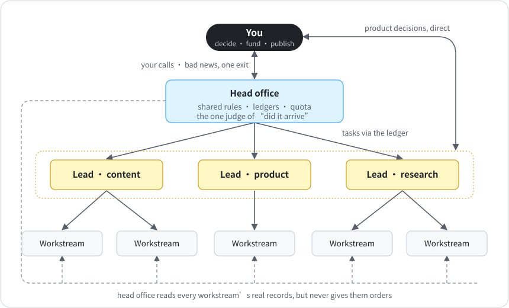

# One-Person AI Company

**English** · [中文](README.zh-CN.md)

**Eight lessons from running a one-person company on 18 Claude Code sessions and about 20 scheduled AI jobs. Each one came from something that broke.**

I run a one-person company. The agents are 18 long-running Claude Code sessions, one per project or lead, and about 20 scheduled jobs that each run their own prompt. They write crypto and AI research briefs, draft posts for my social accounts, and build and monitor [GapMine](https://gapmine.com), a product I'm working on. Most of what they produce lands in a group chat I read every morning.

This repo is the operating system I ended up with after things kept breaking: how the agents are organized, how work survives a cleared session, how I know what actually shipped, and which rules a machine enforces. It's eight short chapters, templates, four Python checks with no dependencies, and an agent skill that helps you set it up in your repo.

[](https://github.com/Balance0014/one-person-ai-company/actions/workflows/ci.yml)  

---

## What broke first

Everything in here was added after one of these happened:

- An agent reported a task as done because it found no errors. Nothing had shipped.
- A session hit the weekly limit mid-task, and everything it knew disappeared with the chat.
- A few days of heavy development burned through my weekly limit, and my morning briefs stopped for four days.
- The job that tells me about missing jobs ran on the same account as the jobs. When the quota ran out it went quiet too, and I heard nothing for five days.
- A rule lived in a scheduled job's prompt and in the repo, and the two copies drifted apart.
- My own monitor sent me 28 messages in one week, and I couldn't act on any of them.

## How it's organized

<p align="center"></p>

HQ is one agent session that owns the shared rules, the ledgers, the quota, and the reconciler that answers "did it arrive?" It gives work only to the four leads, and each lead runs its own projects. Besides bad news and product calls, agents only come to me about money, irreversible deletes, changes to my rules, and publishing. [Chapter 1](playbook/01-org-chart.md) has the rest.

## The chapters

| Chapter | The problem it fixes | Comes with |
|---|---|---|
| [1 · Org chart and who talks to whom](playbook/01-org-chart.md) | Every agent reports to you, and every rule is pasted into every prompt | Role card and decision log templates |
| [2 · The dispatch ledger](playbook/02-dispatch-ledger.md) | Tasks get lost in chat | `scripts/dispatch.py` |
| [3 · Handoff records](playbook/03-handoff-records.md) | A session dies and takes its context with it | `scripts/handoff_check.py` |
| [4 · One judge per question](playbook/04-one-judge-per-question.md) | Agents grade their own homework | `scripts/reconcile.py` |
| [5 · The definition of done](playbook/05-definition-of-done.md) | "Fixed" means "worked once" | `dispatch.py done` |
| [6 · Quota budgets](playbook/06-quota-budget.md) | Development starves the jobs that matter | Budget template |
| [7 · Rules become gates](playbook/07-rules-become-gates.md) | Rules quietly stop being enforced | `scripts/rules_check.py` |
| [8 · Alerts that remember](playbook/08-alerts-that-remember.md) | Alert fatigue, and alerts nobody can act on | Three questions to answer before an alert ships |

## My setup, as of October 28, 2026

| | |
|---|---|
| Agents | 18 long-running Claude Code sessions (HQ, the four leads, and their projects) plus 6 paused ones, and about 20 scheduled jobs |
| Org | HQ, 4 leads, and 45 role cards (one per role, including scheduled jobs and paused projects) |
| Scheduled deliveries | 21 daily and weekly deliveries from those jobs, checked twice a day by a plain script (no model calls) on a separate small server |
| Rules | 170 registered: 82 name the script that blocks them, 41 are checked on a schedule, 47 rely on discipline |
| Dispatch ledger | 67 tasks in six weeks: 33 closed with all five pieces of evidence ([chapter 5](playbook/05-definition-of-done.md)), 8 rejected, 26 still open |
| Handoff records | 24, one per agent session, including paused ones. I've run the drill on 15: hand the repo to a fresh session with no chat history, ask where things stand, and compare its answer with what's actually true |

The failures are in here too, with dates, including the ones that still aren't fixed.

## Try it in 30 seconds

You only need Python 3.9+. Nothing to install.

```bash
git clone https://github.com/Balance0014/one-person-ai-company
cd one-person-ai-company/examples
python3 ../scripts/reconcile.py --date 2026-10-27
python3 ../scripts/handoff_check.py
python3 ../scripts/rules_check.py
```

```
| | Delivery | Due | Result |
|---|---|---|---|
| ❌ | Morning brief | 2026-10-27 09:00 | missing, nothing by 09:40 |

✓ content.md
✗ research.md
    - missing section "## In progress"
    ...
✗ R-06: enforcer scripts/link_gate.py does not exist — Posts with broken links never ship
```

The example data is set up to fail, so you can see what each check catches.

## Use it in your own repo

**As an agent skill.** You'll need Node.js 22.20 or newer for this command:

```bash
npx skills add https://github.com/Balance0014/one-person-ai-company
```

Then tell your agent: *"Set up the one-person AI company structure in this repo."* It copies the templates, asks who your leads are, writes role cards and handoff records with you, and runs the four checks. CI installs the skill this way on every push. The skill uses the open `SKILL.md` format, but I've only used it with Claude Code.

**By hand:**

```bash
cp -r templates/ops templates/ops.config.json /path/to/your/repo/
cp -r scripts /path/to/your/repo/
```

Then run the checks from your repo root:

```bash
python3 scripts/dispatch.py overdue
python3 scripts/handoff_check.py
python3 scripts/reconcile.py
python3 scripts/rules_check.py
```

Each one exits 1 when something is missing, overdue, or broken (a late delivery is only a warning), so you can run them from cron or CI. Claude Code treats exit code 2 as a block (other non-zero codes don't block), so wrap a check to use it in a hook: `python3 scripts/handoff_check.py --record content.md --repo . >&2 || exit 2`.

## The four checks

| Script | What it tells you | Model calls |
|---|---|---|
| `dispatch.py` | What's open, who owns it, and what's late. Won't close a task that was never acked, or while any of the five evidence fields is empty | 0 |
| `handoff_check.py` | Whether each handoff record has a timestamp and all seven section headings, and (with `--record` and `--repo`) whether the project has a commit more than 15 minutes newer than the record. It can't tell whether what's written is true; that's what the drills are for | 0 |
| `reconcile.py` | Whether every scheduled delivery arrived on time, according to what the sender logged | 0 |
| `rules_check.py` | Whether every rule marked as enforced still points to a script that exists and still contains the marker string you chose | 0 |

All paths come from `ops.config.json`, so nothing's hard-coded. The tests check both directions (good input passes, bad input fails): `python3 -m unittest discover tests`.

## Two tools that came out of this

- [**claim-check**](https://github.com/Balance0014/claim-check): a Claude Code hook for [chapter 5](playbook/05-definition-of-done.md). Your agent can't say "fixed" until something has run after its last edit.
- [**when-to-clear**](https://github.com/Balance0014/when-to-clear): for [chapter 3](playbook/03-handoff-records.md) and [chapter 6](playbook/06-quota-budget.md). It shows how much of your usage goes to re-reading long conversations, and writes the handoff note so you can start fresh.

## Limits

- The method is the one I use. The scripts are a clean rewrite, because my production versions are tied to my own servers and accounts, so these are deliberately small.
- The checks only see what you write down. A delivery that isn't in `EXPECTATIONS.json` never gets reported missing.
- `rules_check.py` only checks that a gate's script exists and contains your marker string. It can't prove the script is wired into a hook.
- Nothing runs on its own. You wire the checks into your hooks, cron jobs, or CI. The rule registry template starts every rule as `advisory` until you do.
- Times use a fixed UTC offset (`timezone_offset_hours`), so update it when daylight saving time changes.

## About me

I'm [Balance Zhao](https://github.com/Balance0014). I spent years in growth marketing before I started building. This repo is the method I run on, with everything company-specific taken out. I'll be open-sourcing more of it; [follow me on X](https://x.com/balance0014) if you want to see what's next.

## License

MIT
