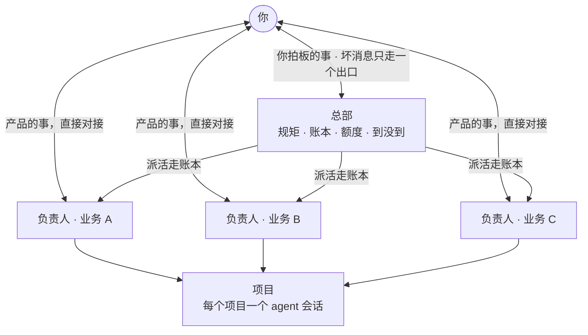

# 一人 AI 公司

[English](README.md) · **中文**

**我一个人带着 30 多个 AI agent 跑一家公司，这是背后那套管理办法，整理成了你能直接拿去用的版本。** 组织架构和沟通线、派活账、交接记录、到没到的对账、完成的定义、额度预算，以及真正由机器执行的规矩。附模板、四个小检查脚本，还有一个能帮你一键搭好的 agent 技能。

[](https://github.com/Balance0014/one-person-ai-company/actions/workflows/ci.yml)   

---

## 为什么做这个

管一个 agent 很简单，管三十个就是管理问题。这里每一样东西，都来自我们真实踩过的坑：

- agent 说「做完了」，依据是「没发现错误」，其实什么都没发出去。
- 账号周额度在任务做到一半时用完，agent 知道的一切跟着聊天记录一起没了。
- 开发把整周额度吃光，大家等着看的定时报告连停四天。
- 本该报告故障的那个报警，跑在已经挂掉的那个东西上。
- 同一条规矩在定时任务的指令里抄了一份、仓库里又有一份，两份慢慢就不一样了。
- 一个报警天天响，响到没人看，真出事那天也没人看。

## 怎么组织的



总部只跟负责人说话；负责人管自己的项目；跨两块业务的事经总部。坏消息只从一个出口到你手上；产品上的事由负责人直接找你；要你拍板的只有四类：花钱、删了找不回、改你定过的规矩、对外发布。完整规矩见[第 1 章](playbook/01-org-chart.md)。

## 里面有什么

| 章节 | 解决什么 | 配套 |
|---|---|---|
| [1 · 组织架构与沟通线](playbook/01-org-chart.md) | 所有人都直接找你；规矩到处抄；什么事都发消息 | 岗位卡、决策记录模板 |
| [2 · 派活账](playbook/02-dispatch-ledger.md) | 活丢在聊天里 | `scripts/dispatch.py` |
| [3 · 交接记录](playbook/03-handoff-records.md) | 账号或额度一断，上下文全没 | `scripts/handoff_check.py` |
| [4 · 一个问题一个裁判](playbook/04-one-judge-per-question.md) | agent 自己给自己判卷 | `scripts/reconcile.py` |
| [5 · 完成的定义](playbook/05-definition-of-done.md) | 「修好了」其实是「试了一次没报错」 | `dispatch.py done` 强制执行 |
| [6 · 额度预算](playbook/06-quota-budget.md) | 开发挤掉真正要紧的定时任务 | 预算模板 |
| [7 · 规矩要变成闸](playbook/07-rules-become-gates.md) | 规矩悄悄失效 | `scripts/rules_check.py` |
| [8 · 有记性的报警](playbook/08-alerts-that-remember.md) | 报警疲劳；报警只说出了什么事、不说该怎么办 | 上线前三问 |

章节正文目前是英文。

## 我们自己的真实数字

不是纸上谈兵。截至 2026 年 10 月 28 日，我们自己这套：

| | |
|---|---|
| agent | 18 个长期在跑的会话（每位负责人、每个项目一个），另有约 20 个定时 agent |
| 架构 | 总部、4 位负责人、45 张岗位卡 |
| 对账的定时产出 | 21 项（日更和周更），对账程序跑在一台小服务器上，每天对两次，不调用任何模型 |
| 规矩 | 登记 170 条：机器挡 82 条，定时查 42 条，还有 46 条靠自觉 |
| 派活账 | 9 月中以来 66 件：33 件带齐五样证据关单，8 件写明理由拒绝，25 件未关 |
| 交接记录 | 24 份；其中 15 份做过演练：开一个没有任何聊天记录的新会话，只看记录接手 |

最糟的一段也写进去了：有一次停摆 18 天，对账程序每天早上都报对了，但还是没能让问题早一点解决（见[第 4 章](playbook/04-one-judge-per-question.md#what-it-looked-like-for-us)）。

## 30 秒看效果

不用安装，只要 Python 3.9+ 和自带的标准库：

```bash
git clone https://github.com/Balance0014/one-person-ai-company
cd one-person-ai-company/examples
python3 ../scripts/reconcile.py --date 2026-10-27
python3 ../scripts/handoff_check.py
python3 ../scripts/rules_check.py
```

示例数据是故意做成会报错的，方便你一眼看懂每个检查在抓什么。

## 用到你自己的仓库

**作为 agent 技能**（Claude Code 等能读 `SKILL.md` 的 agent）：

```bash
npx skills add https://github.com/Balance0014/one-person-ai-company
```

然后对你的 agent 说：「在这个仓库里搭好一人 AI 公司的结构。」它会复制模板、问你有哪几位负责人、写好岗位卡和交接记录，再把四个检查跑一遍。每次更新，CI 都会用这条命令真装一遍。

**手动：** 把 `templates/ops`、`templates/ops.config.json` 和 `scripts/` 复制到你的仓库，在仓库根目录跑：

```bash
python3 scripts/dispatch.py overdue
python3 scripts/handoff_check.py --repo .
python3 scripts/reconcile.py
python3 scripts/rules_check.py
```

有问题就返回 1，可以直接接进钩子、定时任务或 CI。四个脚本都不调用模型，路径全在 `ops.config.json` 里配置，没有写死的路径。测试正反两个方向都覆盖：`python3 -m unittest discover tests`。

## 局限

- **这些脚本是重新写的干净版**，不是我们的生产代码（那套绑着我们自己的服务器和账号）。方法一样，工具故意做得很精简。
- **我们日常用的是 Claude Code。** 技能按开放的 `SKILL.md` 格式写，但没在别的 agent 上测过。
- **检查只看得见你写下来的东西。** 没登记进 `EXPECTATIONS.json` 的产出，没到也不会报。
- **它不会自己动起来。** 检查要你自己接进钩子、定时任务或 CI。

## 作者

我是 [Balance Zhao](https://github.com/Balance0014)，市场运营出身的开发者。我带着 30 多个 agent 写文章、做投研、调研产品、维护我自己 vibe coding 的产品，包括 [GapMine](https://gapmine.com)。这个仓库就是这套做法，去掉了所有公司内部的细节。

更多方法会陆续开源，[在 X 上关注我](https://x.com/balance0014)。

## 许可

MIT
