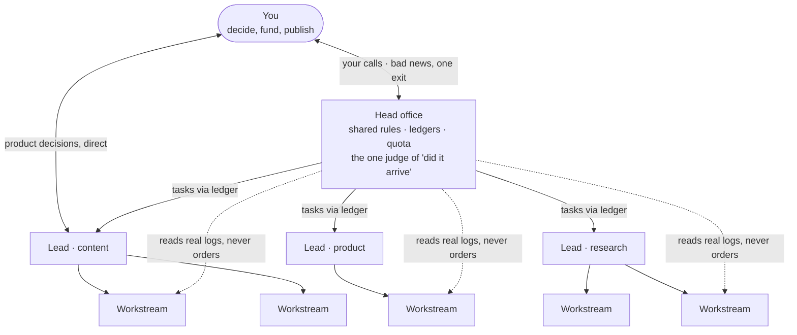

# 1 · Org chart and lines of communication

## The problem

With five agents you can keep everything in your head. With thirty you cannot. Every agent reports straight to you, every rule is copied into every agent's instructions, and within a month the copies disagree. You become the bottleneck, your inbox fills with noise, and the one message that matters looks like all the others.

## Three layers

| Layer | Who | Owns |
|---|---|---|
| Head office | One coordinating agent session | Shared rules, the ledgers, the one judge of "did it arrive", the single exit for bad news, shared infrastructure and quota |
| Leads | One agent per business area (content, product, research…) | That area's quality bar, its own checks, scheduling and assigning work |
| Workstreams | One agent session per project | Doing the work. They take direction from their lead |

Head office does not write product code or judge content quality. If it spots a problem inside an area, it tells that area's lead instead of fixing it.

## Where you sit

The point of the layers is that you talk to fewer agents, less often, about things only you can decide.

- **Product decisions go straight between you and the lead.** Head office does not relay them and does not decide on your behalf. Relaying adds a hop and loses detail; deciding for you takes away a call that is yours.
- **Head office brings you two kinds of things:** bad news, through one exit (see [chapter 4](04-one-judge-per-question.md)), and the decisions reserved for you.
- **Reserved for you:** spending money, deleting anything that cannot be recovered, changing a rule you set, and publishing anything outside the company. Everything else is done first and reported after.
- **Check before asking.** Keep a decision log (date, your exact words, what it changed; template: [`templates/ops/DECISIONS.md`](../templates/ops/DECISIONS.md)). Before an agent asks you anything, it searches the log. If you already decided, it acts on that decision and does not ask again.
- **How agents talk to you:** the first sentence is the conclusion. Plain words, no internal jargon. Results and impact, not process. One question, one answer.

## How messages flow

| Direction | Rule |
|---|---|
| Down | Head office talks only to leads, never to a lead's workstreams. Leads talk to their own workstreams. |
| Up | Only leads report to head office. A lead never reports on another lead's area. |
| Sideways | Anything that crosses two areas goes through head office. |
| Read access | Never taken away. Head office can read any workstream's real records (logs, delivery records, commits) without asking. Bad news must not be able to hide behind a layer. |

**The ledger first, messages second.** Tasks and conclusions are written into the [dispatch ledger](02-dispatch-ledger.md), and the other side reads them when it reaches a natural stopping point. A message is only for two cases: you need a decision now, or you are blocked. A day's small items are batched into one message. Nobody sets a recurring alarm to poll another agent.

We learned this one the expensive way. To unstick agents that went quiet, we once had every agent wake up every 20 minutes. The wake-ups took about 30% of every session's calls, and we removed them the next day. The real cause was a single tool that hung without anyone noticing.

## Rules live in one layer

Head office sets rules for *how* to work: the definition of done, quota, handoff records, how to talk to you. Leads set rules for *what good looks like* in their area. A lower layer may add rules but never copies or contradicts a higher one. When they collide, working discipline follows head office and business judgment follows the lead. A real conflict goes to head office and gets fixed in one place.

## Role cards

Every role gets four lines at the top of its own instruction file: what it delivers, what it owns, how good is good enough, and what enforces it. Template: [`templates/ROLE-CARD.md`](../templates/ROLE-CARD.md).

"Delivers" must be a checkable result, never a list of steps. A reviewer agent's card does not say "answer these six questions". It says "responsible for every approved draft being correct and publishable". We keep 45 role cards this way, and a scheduled check flags any card whose "Delivers" line is only a pointer to somewhere else.

## What it costs

Nothing to run. The cost is discipline: when you are tempted to fix a workstream yourself from head office, or to message a workstream directly, you hand it to the lead instead.
