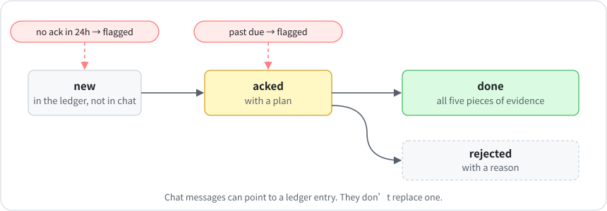

# 2 · The dispatch ledger

**English** · [中文](zh-CN/02-dispatch-ledger.md)

I used to ask an agent to fix something in chat. Then the session got cleared, or a different agent took over the area the next week, and the request was gone. Nothing told me it had been dropped.

These days every task that crosses a layer (HQ to a lead, a lead to HQ, one area to another) lives in a single file in the repo:

<p align="center"></p>

- The owner acknowledges within 24 hours, or the task gets flagged.
- An open task past its due date gets flagged.
- Closing a task takes a plan on record and all five pieces of evidence from [chapter 5](05-definition-of-done.md). The script won't close it before it's been acked, or while any of the five is empty.
- Chat messages can point to a ledger entry; they don't replace one.

## Commands

```bash
python3 scripts/dispatch.py add --to content --title "Morning brief arrived late twice this week"
python3 scripts/dispatch.py ack D-20261020-01 --plan "Replay the scheduler log for the last 7 days"
python3 scripts/dispatch.py done D-20261020-01 \
  --root-cause "Scheduler used UTC; the brief's cron assumed local time" \
  --prevention "test_cron_timezone fails on any cron without an explicit zone" \
  --sweep "Checked all 21 schedules; two others had the same bug, both fixed" \
  --verification "Brief arrived at 09:00 on Oct 22 and Oct 23" \
  --cleanup "Deleted the debug cron and the scratch log"
python3 scripts/dispatch.py overdue   # exits 1 if anything is late; run it on a schedule
```

Each lead's session lists its own open tasks when it starts: `python3 scripts/dispatch.py list --to content --open`.

## Results so far

As of October 28, 2026, my ledger holds 67 tasks from the past six weeks. Of those, 33 are closed with all five pieces of evidence, 8 were rejected with a reason, 9 are in progress, and 17 haven't been acknowledged, 13 of them past their due date.

So the 24-hour rule gets broken a lot. It hasn't made anyone faster, but those 13 tasks now show up on a daily list with an owner's name instead of sitting in old chats nobody reopens. That list goes to HQ, not to me. It used to land in my chat, which is part of the story in [chapter 8](08-alerts-that-remember.md).
