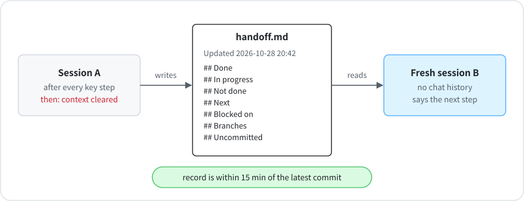

# 3 · Handoff records

**English** · [中文](zh-CN/03-handoff-records.md)

A session would hit the weekly limit in the middle of a task, or fill its context window and get cleared. Everything it knew lived in the conversation. The next session started from zero and redid the work, or undid it.

Now every agent session (each lead and each project) keeps one handoff file in the repo. A fresh session with no chat history, possibly on a different account, has to be able to read it and say exactly what to do next.

<p align="center"></p>

- Line one: `Updated YYYY-MM-DD HH:MM`, plus which files to read first.
- Seven fixed sections: Done · In progress · Not done · Next · Blocked on · Branches · Uncommitted or unpushed.
- Update it after every key step: a commit, a release, a decision, a change of direction. Don't wait for the quota to run low; by then the session may not get another turn.
- It lives in the repo and gets pushed, so it survives losing the account.

Template: [`templates/HANDOFF.md`](../templates/HANDOFF.md).

## Checking it

```bash
python3 scripts/handoff_check.py                                    # every record: seven sections and a timestamp
python3 scripts/handoff_check.py --record content.md --repo ../content   # one record vs. its project's latest commit
```

To make an agent keep its record current, run the second form in that session's stop hook. Claude Code only blocks on exit code 2 and reads the reason from stderr, so wrap it:

```bash
python3 scripts/handoff_check.py --record content.md --repo . >&2 || exit 2
```

The agent then can't end a turn while the repo has commits newer than its record.

My first version of this check had a hole. It treated a record as fresh if it had been updated within two hours of the latest commit, so a session could write the record, keep working for another 90 minutes, and still pass. The check here allows 15 minutes, enough to stamp the record, commit, and push.

## Drills

Every so often, open a fresh session, give it only the repo, and ask where each project stands and what comes next. Then compare its answer with reality, line by line.

I keep 24 records, including 6 for paused projects. Before I trusted the setup, I ran this drill on 15 of them. Every drill found mismatches, usually five or more: a "next step" that was already done, a task marked unclaimed that someone was already working on, a setting the record placed in one file that was actually in nine. On the day I wrote this, the start-of-session check flagged 7 of the 24 as stale or incomplete.
