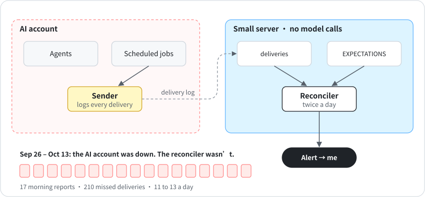

# 4 · One judge per question

**English** · [中文](zh-CN/04-one-judge-per-question.md)

From September 11 to 16, 2026, my account hit its weekly limit, and every scheduled AI job failed at launch with a usage-limit error. The script that compares expected deliveries with actual ones runs on its own small server, so it kept going and logged the gap. The job that was supposed to tell me about it ran on the same account, though, so it failed too. I found out on the 16th, after the limit reset, when my product lead spotted the gap and flagged it to HQ.

Ask an agent "did today's report go out?" and it'll usually say yes. Often it's going off its own plan, or a log line that says "sending...". I also had three separate checks answering "did it arrive?" three different ways, and they disagreed.

My rule now: each question has exactly one judge, and the judge reads only hard evidence.

| Question | Judge | Reads |
|---|---|---|
| Did it arrive? | The reconciler | The schedule file vs. what the *sender* logged |
| Is it any good? | The area's lead | Its own quality checks |
| Is anything stuck? | `dispatch.py overdue` and `handoff_check.py`, on a schedule | The dispatch ledger and the handoff records |

<p align="center"></p>

- The delivery log is written by whatever sends the output, never by the agent that did the work.
- Bad news has one channel, and that channel can't depend on the thing it watches. If your scheduler can die, the alarm about the scheduler can't run on it.
- Before adding a check, ask whether the question already has a judge. If it does, read that verdict instead of writing a second one.

## Running it

1. List everything that should arrive on a schedule in `ops/EXPECTATIONS.json` (`"daily 09:00"`, `"weekly mon 17:00"`, plus a grace window).
2. Have whatever sends each output append one line to `ops/deliveries.jsonl`.
3. Run the reconciler the next morning:

```bash
python3 scripts/reconcile.py --date 2026-10-26
```

```
| | Delivery | Due | Result |
|---|---|---|---|
| ✅ | Morning brief | 2026-10-26 09:00 | on time |
| 🟡 | Weekly report | 2026-10-26 17:00 | late, arrived 19:05 |
```

Run it somewhere that doesn't share a fate with your agents, like a small server or a CI job. It makes no model calls, so it keeps running when your quota doesn't.

## The 18 days

After September 16, my reconciler started sending its own alerts instead of handing them to an agent.

From September 26 to October 13, none of my AI-run scheduled jobs started. The account hit its usage limit, then the plan lapsed. That part's on me: I didn't renew it until October 14. Every agent that might have investigated was down too, but the reconciler kept running. Over those 18 days its morning reports listed 210 missed deliveries, 11 to 13 a day, and it messaged me almost every morning. It even guessed the cause: when that many deliveries go missing at once, check the account's quota first.

So the judge did its job. What it got wrong was the owner. It assigned the quota problem to HQ, an agent on the same dead account. [Chapter 8](08-alerts-that-remember.md) is about naming an owner who can act.
