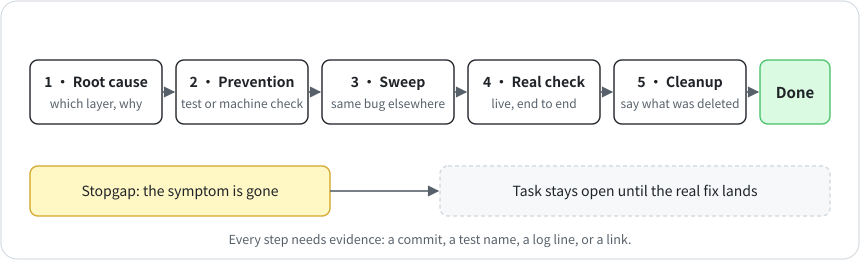

# 5 · The definition of done

**English** · [中文](zh-CN/05-definition-of-done.md)

One of my projects kept going quiet in the middle of tasks. An agent's fix was to wake every agent every 20 minutes. It ran for a day. The wake-ups ate about 30% of every session's usage, and the actual cause turned out to be a single tool that hung without anyone noticing.

By most agents' standards that fix was done, because the symptom went away. Agents call something fixed when they've tried it once and seen no error, and they report a stopgap as a fix. So I wrote down what done means.

A task is done only when all five of these are true, each backed by evidence (a commit, a test name, a log line, a link):

1. **Root cause.** Which layer was actually wrong, and why.
2. **Prevention.** A regression test, a replay of past data, or a machine check that would catch it next time.
3. **Sweep.** The same mistake elsewhere: how many places, and were they fixed?
4. **Real verification.** Verified end to end on real data or in production: the scheduled job ran again and the person got the output.
5. **Cleanup.** Test files, temporary copies, retired code, schedules, and references are deleted, and you can say what was deleted.

The rules that go with it:

- A stopgap isn't a fix. Ship one if you have to, but the task stays open until the real fix lands.
- If an item truly doesn't apply, write `n/a: <reason>`. Leaving it blank isn't allowed, and invented evidence is worse than a blank.
- Reproduce the problem before you change anything, then verify the fix with the same check.
- Before proposing a fix, estimate what it'll cost to run every day. The 20-minute wake-up would have failed that on paper.
- Roll back with version control. No `file.bak`, no archive folders, no old and new versions living side by side.

## Enforcing it

`scripts/dispatch.py done` won't close a task that was never acked with a plan, or while any of the five fields is empty. It can't tell whether the evidence holds up. That's for whoever assigned the task to judge.
