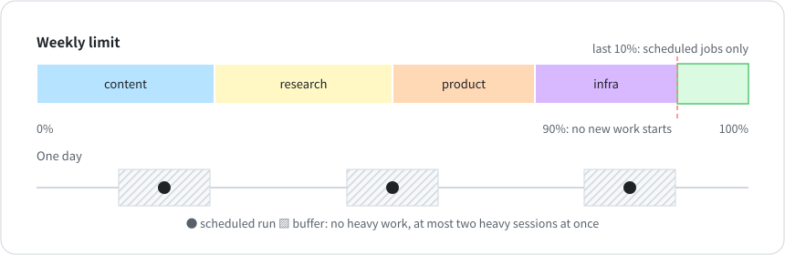

# 6 · Quota budgets

**English** · [中文](zh-CN/06-quota-budget.md)

From September 19 to 22, 2026, a few days of heavy development burned through my weekly limit. My scheduled AI jobs failed at launch with a usage-limit error, and the morning briefs stopped for four days. It was the second quota outage that month (the first is in [chapter 4](04-one-judge-per-question.md)). Those jobs and my development sessions draw from the same pool, and nothing protected the jobs.

On September 23 the same thing hit the five-hour limit: nine sessions doing heavy work at once took it from 25% to 74% in half an hour.

## The rules

- Scheduled deliveries come first. At 90% of the weekly limit, no session starts new work, and the last 10% keeps scheduled jobs running.
- Each area gets a weekly budget ([`templates/QUOTA-BUDGET.json`](../templates/QUOTA-BUDGET.json)). An area over budget stops starting new work until the week resets or HQ grants more. Without per-area budgets one area can stop everyone: on October 21 and 22 the account burned 78% of its weekly limit, and by my estimate 63 points of that came from one area.
- At most two sessions do heavy work at a time. Heavy means sub-agents, large scans, and big refactors. Reading results and replying to messages don't count.
- Heavy work stays away from scheduled run times, with a buffer before and after each job.
- A missed scheduled job is never re-run automatically. If a report didn't go out, a person decides whether to send it late. Automatic re-runs pile up during an outage and flood everyone when it ends.

## Enforcing it

The budget file is just data. Enforcement belongs in your agent's pre-tool hook: map the session's working directory to an area, compare that area's usage with its budget, and block file edits and sub-agents when it's over. Claude Code doesn't give hooks your account usage, and Claude doesn't report usage by area, so I estimate it. My sessions write the account's weekly percentage to a file whenever they check it. A script reads the token counts in each session's local log, assigns each session to an area by its working directory, and splits the weekly percentage accordingly. Scheduled cloud jobs don't leave local logs, so it's an estimate. If the reading is more than six hours old, the hook blocks once to force a fresh one.

If you add an override for "this protects a scheduled delivery", make it expire within hours. Mine used to last until the end of the day, so one session's one-line note let every session past the gate until then.

## Results so far

Per-area budgets went in on October 22. In the six days since, the reconciler hasn't reported a single missed delivery. Six days isn't enough data yet.
