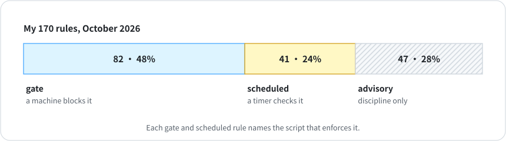

# 7 · Rules become gates

**English** · [中文](zh-CN/07-rules-become-gates.md)

One of my content rules was registered as "checked on a schedule." When the registry check went looking for the script that runs it, there wasn't one. The rule had been sitting in a file for almost two weeks, enforced by nothing.

Most of my rules that stopped working failed in one of two ways. Either the rule lived only in an agent's instructions, which worked for a week until the instructions got long, the rule got skimmed, and the old behavior came back. Or someone rewrote the script that enforced it, and the rule was still written down with nothing checking it.

## Tiers

Every rule says which tier it's in on the day it's created:

| Tier | Meaning |
|---|---|
| `gate` | A machine blocks the wrong action: a hook, a pre-commit check, a CI step |
| `scheduled` | A job checks it on a timer and reports |
| `advisory` | It relies on discipline, and the registry says so |

- Gate and scheduled rules name the file that enforces them, plus a marker string that must appear in it.
- Don't mark a rule `gate` unless something actually blocks it. A fake gate tells everyone the problem is handled, so nobody watches for it.
- Each fact lives in one file, and everything else links to it. Hand-edited copies drift; mine did within weeks.
- Before changing a rule or a script, list everything downstream that reads it. After the change, check each one.
- Keep always-loaded instruction files short. I cap mine at about 200 lines, because past that they get skimmed.

Template: [`templates/ops/RULES-REGISTRY.json`](../templates/ops/RULES-REGISTRY.json).

## Checking it

```bash
python3 scripts/rules_check.py
```

```
4 rules: 3 gate · 0 scheduled · 1 advisory
✗ R-06: enforcer scripts/link_gate.py does not exist — Posts with broken links never ship
```

Run it at the start of every session and a dead gate shows up the day it dies. It checks that the enforcing script exists and still contains the marker string you chose, such as a function name. It can't prove the script is wired into a hook, so that part is still on you.

## Where I am

<p align="center"></p>

Across HQ and four leads I have 170 registered rules. 82 name the script that blocks them (48%), 41 are checked on a schedule (24%), and 47 rely on discipline (28%), including the content rule above.
