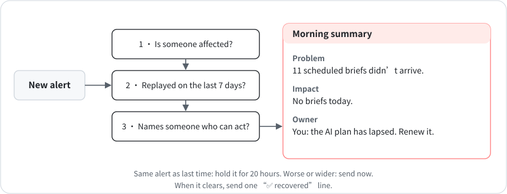

# 8 · Alerts that remember

**English** · [中文](zh-CN/08-alerts-that-remember.md)

In one week in October 2026, my own HQ monitor sent me 28 messages, mostly the same overdue internal tasks repeated every day. I couldn't act on any of them. In September I'd had a worse version of the same problem: the job that should have warned me ran on the same account as everything it watched, so when the quota ran out, nothing reached me for five days ([chapter 4](04-one-judge-per-question.md)).

## Before an alert ships

1. **Does it mean someone is affected?** "A report didn't arrive", "a number is stale", "a page won't load". An error showing up in a log doesn't count. Compare against a baseline or use a ratio; made-up absolute thresholds fire at the wrong times.
2. **What happens if you replay it against the last 7 days?** Count how often it would have fired and check whether someone was really affected each time. If even one case is wrong, fix the rule before it ships.
3. **Who can act on it, and what exactly should they do?** Name someone who'll still be up when the thing being watched is down. If the cause could be the account or the bill, that someone is you, and the alert should say "renew the plan", not "11 deliveries missing." If nobody who reads it can act, keep it out of their channel and put it in a ledger the responsible lead works through.

## How alerts behave

- Only report changes. If an alert would say exactly what it said last time, suppress repeats for 20 hours. If the problem gets worse or spreads, send it right away.
- When the problem clears, send one "✅ recovered" line and forget it.
- Keep changing numbers out of the de-duplication key. If the key contains "3 hours ago", de-duplication never matches.

Every red alert has three parts, in this order:

- **Problem:** one plain sentence that names the thing (which report, which source). No function names, field names, or URLs.
- **Impact:** what the reader will notice: it didn't arrive, the numbers are stale, you're losing money.
- **Owner:** which lead, or HQ, or you.

## Results so far

After the 28-message week, internal backlog moved out of my chat and into a ledger HQ works through. My daily summary now opens with one sentence: what's missing, and whether I need to do anything.

One case stayed open until October 28. When many jobs stopped at once, my alert guessed quota and assigned it to HQ, which runs on the same account and is down too. Now, when three or more AI-run deliveries are missing in one check, the alert asks me to look at the Claude account, says what to do (renew the plan if it lapsed; if the weekly limit is used up, wait for the reset or buy more), and lists me as the owner. Scattered misses, or misses from jobs that don't use the AI account, still say I don't need to do anything. Replayed against 91 past reports from September 11 to October 28, the new rule fires on 35, and two false alarms the old rule raised no longer fire. It takes effect from the next check.
