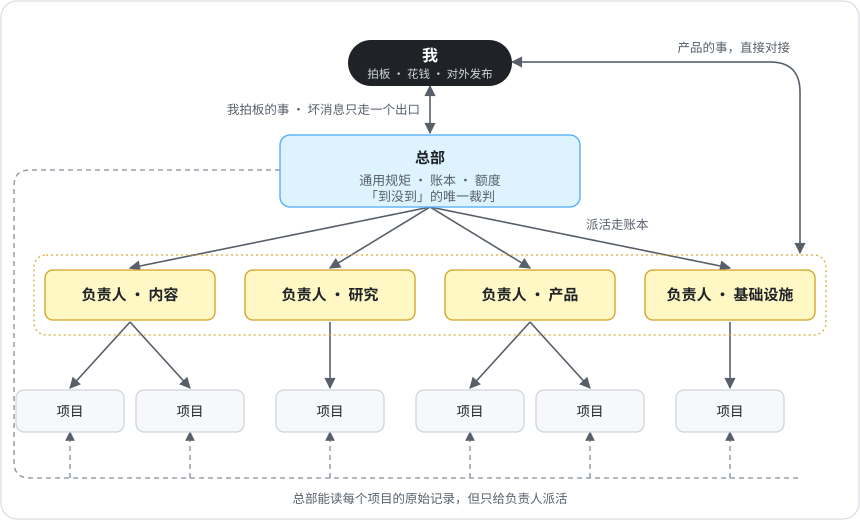

# 1 · 组织架构：谁跟谁说话

[English](../01-org-chart.md) · **中文**

agent 过了十几个之后，我就管不过来了。每个 agent 都直接找我，每条规矩都抄进每份提示词，没多久各处的版本就对不上了。所有事都卡在我这里，要紧的那条消息淹在一堆消息里，看着和别的没两样。

所以我把这些 agent 当成一家小公司来管，分三层。

| 层 | 是谁 | 管什么 |
|---|---|---|
| 总部 | 一个负责协调的 agent 会话 | 通用规矩、各本账、额度，还管着回答「到底发没发出去」的对账脚本。对账脚本跑在 AI 账号之外，是坏消息到我这里的唯一通道 |
| 负责人 | 每块业务一个 agent。我有四位：内容、研究、产品、基础设施 | 自己这块的质量标准、自己的检查、排期和派活 |
| 项目 | 每个项目一个 agent 会话 | 具体干活，听自己负责人的 |

总部不写产品代码，也不评判内容好坏。它在某块业务里发现问题，就告诉那块的负责人，由负责人去修。哪怕总部自己动手更快，也得这么办。

## 我在哪

分层是为了让我只跟少数几个 agent 打交道，少被打扰，只处理非我不可的事。

- 产品上的事，我直接和管这个产品的负责人定。总部不转话（转一道就丢细节），也不替我拍板。
- 坏消息只走一个通道到我这里（见[第 4 章](04-one-judge-per-question.md)）。
- 总部只拿非我拍板不可的事来找我：花钱、删了找不回来的东西、改我定过的规矩、任何对外发布。其余的先做，做完再报。
- 问我之前先查。我有一份决策记录，写着日期、我的原话、改了什么（[`templates/ops/DECISIONS.md`](../../templates/ops/DECISIONS.md)）。里面已经有答案的，照着办，不再来问我。
- 跟我说话，第一句就是结论，用大白话，不讲过程。

## 谁跟谁说话

| 方向 | 规矩 |
|---|---|
| 往下 | 总部只给负责人派活，从不直接找负责人手下的项目。负责人管自己的项目。 |
| 往上 | 只有负责人向总部汇报，而且只报自己那块。 |
| 横向 | 跨两块业务的事，都经总部。 |
| 查看 | 总部不用打招呼，就能直接看任何项目的原始日志、送达记录和提交，负责人想捂也捂不住。 |

活和结论都记进[派活账](02-dispatch-ledger.md)，对方手头这件做完再去看。只有两种情况才直接发消息：要对方马上拍板，或者自己卡住了。一天的零碎事合成一条发。谁也不许定闹钟去催别的 agent。我试过每 20 分钟把 agent 叫醒一次，代价写在[第 5 章](05-definition-of-done.md)。

## 一条规矩只有一个家

总部定「怎么干活」的规矩：什么叫做完、额度、交接、怎么跟我说话。负责人定自己那块「什么叫好」。下一层可以加规矩，但不抄、不和上一层冲突。两条规矩撞了，干活的规矩听总部，业务上的判断听负责人，改也只改一个文件。

## 岗位卡

每个角色的说明文件最上面都有四行：交什么结果、管什么、做到什么程度算合格、靠什么保证。模板：[`templates/ROLE-CARD.md`](../../templates/ROLE-CARD.md)。

「交什么结果」这一行必须写成能检查的结果。我的审稿 agent，卡上不列它要问的六个问题，写的是它放行的每一篇都准确、能直接发。这样的卡我有 45 张，每个角色一张，定时任务和暂停的项目也算在内。还有一个定时检查，专门抓「交什么结果」只写了一句「见某处」的卡。
