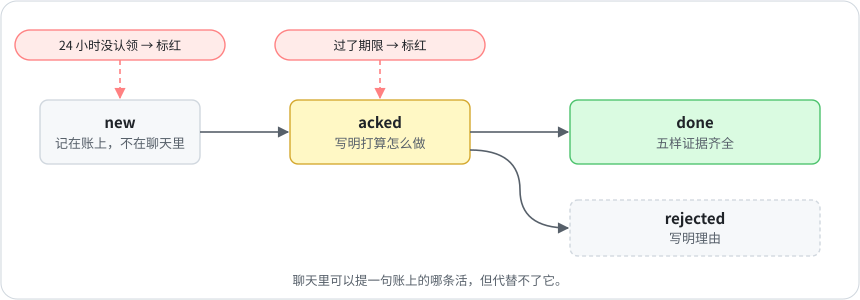

# 2 · 派活账

[English](../02-dispatch-ledger.md) · **中文**

以前我在聊天里让 agent 修个东西。后来会话被清空了，或者下周换了个 agent 接手这块，这件事就没了，也没人提醒我它被漏掉了。

现在，凡是跨层的活（总部给负责人、负责人报总部、一块业务找另一块），都记在仓库里的同一个文件里：

<p align="center"></p>

- 接活的一方 24 小时内认领，不然就标红。
- 过了期限还没关的，标红。
- 关单要有认领时写下的计划，还要带齐[第 5 章](05-definition-of-done.md)的五样证据。没认领过的不让关，五样缺一样也不让关。
- 聊天里可以提账上的某条活，但不能拿聊天代替记账。

## 命令

```bash
python3 scripts/dispatch.py add --to content --title "Morning brief arrived late twice this week"
python3 scripts/dispatch.py ack D-20261020-01 --plan "Replay the scheduler log for the last 7 days"
python3 scripts/dispatch.py done D-20261020-01 \
  --root-cause "Scheduler used UTC; the brief's cron assumed local time" \
  --prevention "test_cron_timezone fails on any cron without an explicit zone" \
  --sweep "Checked all 21 schedules; two others had the same bug, both fixed" \
  --verification "Brief arrived at 09:00 on Oct 22 and Oct 23" \
  --cleanup "Deleted the debug cron and the scratch log"
python3 scripts/dispatch.py overdue   # 有超期的，退出码就是 1，适合定时跑
```

每位负责人的会话一开工，先列出自己没关的活：`python3 scripts/dispatch.py list --to content --open`。

## 目前的结果

截至 2026 年 10 月 28 日，我的派活账在六周里记了 67 件。其中 33 件带齐五样证据关单，8 件写明理由拒掉，9 件在做，17 件还没人认领，这 17 件里有 13 件已经过了期限。

所以「24 小时内认领」这条经常做不到。派活账没让谁变快，但这 13 件活现在每天都出现在一张清单上，旁边写着归谁，不会再沉在没人翻的旧聊天里。这张清单发给总部，不发给我。它以前是发到我这里的，那段经历写在[第 8 章](08-alerts-that-remember.md)。
