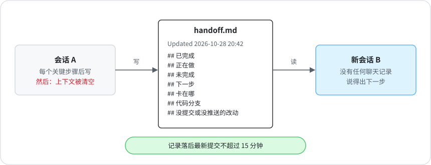

# 3 · 交接记录

[English](../03-handoff-records.md) · **中文**

会话做到一半用完周额度（Claude 订阅每周的用量上限），或者上下文塞满被清空。前面攒下的上下文全跟着聊天记录没了，下一个会话只能从零开始，把做过的再做一遍，甚至把做好的又改坏。

现在每个 agent 会话（每位负责人、每个项目）都在仓库里留一份交接记录。一个没有任何聊天记录的新会话，读完它就要能说出下一步具体做什么。

<p align="center"></p>

- 第一行写 `Updated YYYY-MM-DD HH:MM`，再写先读哪几个文件。
- 固定七项：已完成 · 正在做 · 未完成 · 下一步 · 卡在哪 · 代码分支 · 没提交或没推送的改动。标题用中文或英文（`## Done` 等）都行，检查脚本两种都认。
- 每做完一个关键步骤就更新：提交代码、上线、拍板、换方向。别等额度快用完才写，到那时会话可能已经没有下一轮了。
- 记录放在仓库里并推上去，会话没了它还在。

模板：[`templates/HANDOFF.md`](../../templates/HANDOFF.md)。

## 怎么检查

```bash
python3 scripts/handoff_check.py                                    # 所有记录：七项齐不齐、有没有时间
python3 scripts/handoff_check.py --record content.md --repo ../content   # 一份记录对比它那个项目的最新提交
```

想让 agent 自己把记录保持最新，就把第二条放进那个会话的 Stop 钩子（Claude Code 每轮结束时触发的钩子）。Claude Code 把退出码 2 当作「拦下」，并把 stderr 的内容给 agent 看（其他非 0 的退出码不拦），所以要这样包一层：

```bash
python3 scripts/handoff_check.py --record content.md --repo . >&2 || exit 2
```

这样只要仓库里有比记录新 15 分钟以上的提交，agent 这一轮就结束不了。还没提交的改动，检查是看不见的。这一行命令每次检查不过都会拦。Claude Code 连着拦八次后会结束这一轮，所以 agent 修不好记录也不会被永远卡住；更干净的做法是写个小包装，读钩子输入里的 `stop_hook_active`，第二次就放行。

我第一版检查有个漏洞：记录只要没落后最新提交两小时以上，就不算过期。于是一个会话可以写完记录，再干一个半小时，照样通过。这里的检查只留 15 分钟，刚好够写完记录、提交、推送。

## 演练

隔一段时间，开一个新会话，只给它仓库，问它每个项目做到哪了、下一步是什么。然后拿它的回答和实际情况逐条对。

我一共有 24 份记录，其中 6 份属于暂停的项目，对其中 15 份做过演练。每一次都查出了对不上的地方，通常五处以上：写着「下一步」的事其实早做完了；写着「没人认领」的活其实有人在做；记录说某个配置在一个文件里，实际散在九个文件里。写这一章的那天，开工检查还是标出 24 份里有 7 份过期或缺项。
