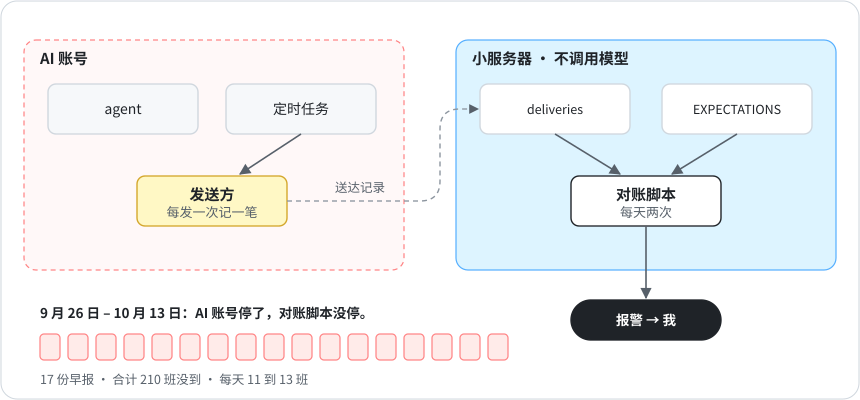

# 4 · 一个问题一个裁判

[English](../04-one-judge-per-question.md) · **中文**

2026 年 9 月 11 日到 16 日，我的账号撞上周额度上限，所有 AI 定时任务一启动就报额度不足，直接失败。对账脚本跑在一台单独的小服务器上，所以照常运行，把缺的产出都记了下来。可负责通知我的那个任务和其他任务跑在同一个账号上，也一样失败了。我是 16 号额度重置之后才知道的，因为管产品的负责人发现了缺口，报给了总部。

问 agent「今天的报告发出去了吗」，它多半会说发了。它的依据往往只是自己的计划，或者一行「正在发送……」的日志。我当时还有三个检查，各用各的办法判断「到没到」，结论还互相打架。

现在的规矩是：一个问题只有一个裁判，裁判只看硬证据。

| 问题 | 裁判 | 看什么 |
|---|---|---|
| 到没到？ | 对账脚本 | 排班表，对比**发送方**记下的送达记录 |
| 好不好？ | 这块业务的负责人 | 它自己的质量检查 |
| 有没有卡住的？ | 定时跑 `dispatch.py overdue`，以及每个项目各跑一次 `handoff_check.py --record <名字> --repo <路径>` | 派活账和交接记录 |

<p align="center"></p>

- 送达记录由真正把东西发出去的那一环来写，绝不由干活的 agent 自己写。
- 坏消息只有一个通道，而且这个通道不能依赖它要盯的东西。调度器可能挂，「调度器挂了」这条报警就不能靠调度器来发。
- 加新检查之前，先问这个问题是不是已经有裁判了。有，就读它的结论，别再写一个。

## 怎么跑

1. 把所有按时该到的东西写进 `ops/EXPECTATIONS.json`（`"daily 09:00"`、`"weekly mon 17:00"`，再加一段宽限时间）。
2. 让负责发送的那一环每发一次，就往 `ops/deliveries.jsonl` 追加一行。
3. 第二天早上跑对账：

```bash
python3 scripts/reconcile.py --date 2026-10-26
```

```
| | Delivery | Due | Result |
|---|---|---|---|
| ✅ | Morning brief | 2026-10-26 09:00 | on time |
| 🟡 | Weekly report | 2026-10-26 17:00 | late, arrived 19:05 |
```

把它放在不会和 agent 一起挂掉的地方跑，比如一台小服务器或者 CI。它不调用任何模型，额度用完了它照样能跑。

## 目前的结果

从 9 月 16 日起，我的对账脚本在自己那台服务器上每天跑两次，有问题直接给我发报警，中间不经过任何 agent。它现在盯着 21 项定时产出。
