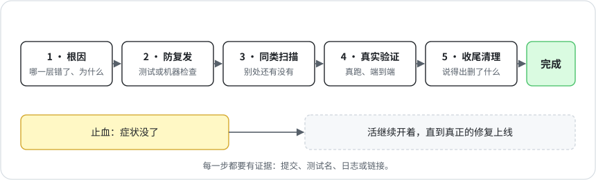

# 5 · 完成的定义

[English](../05-definition-of-done.md) · **中文**

有个项目老是干到一半就没动静了。有人提的修法是：所有 agent 每 20 分钟叫醒一次。这个办法跑了一天。叫醒本身吃掉了每个会话大约 30% 的用量，而真正的原因是某个工具卡住了，一直没人发现。

按大多数 agent 的标准，这已经算修好了，因为症状没了。agent 试一次没报错就说修好了，把止血当成治好。所以我把「做完」写成了明确的标准。

一件活只有下面五样都成立才算做完，每样都要有证据（提交、测试名、日志或链接）：

1. **根因。** 到底是哪一层出的错，为什么。
2. **防复发。** 一条回归测试、一次历史数据回放，或者一道下次能拦住它的机器检查。
3. **同类扫描。** 同样的错别处还有没有：有几处，修了没有？
4. **真实验证。** 在真实数据或线上端到端验过：定时任务真的又跑了一次，人真的收到了东西。
5. **收尾清理。** 测试文件、临时副本、废弃代码、定时任务和引用都删干净，而且说得出删了什么。

配套的几条：

- 止血不算修好。真要先止血可以，但这件活一直开着，直到真正的修复上线。
- 某一样确实不适用，就写 `n/a: <理由>`。不许留空，编造证据比留空更糟。
- 动手改之前先把问题复现出来，改完用同一个检查去验。
- 提修法之前，先估一估它每天要花多少。「每 20 分钟叫醒一次」在纸面上就过不了这一关。
- 回滚靠版本历史。不留 `file.bak`，不建存档文件夹，新旧两版不并存。

## 怎么保证

`scripts/dispatch.py done` 遇到没认领过的活不让关，五样里有一样空着也不让关。证据靠不靠得住，它判断不了，得由派活的那一方来判。
