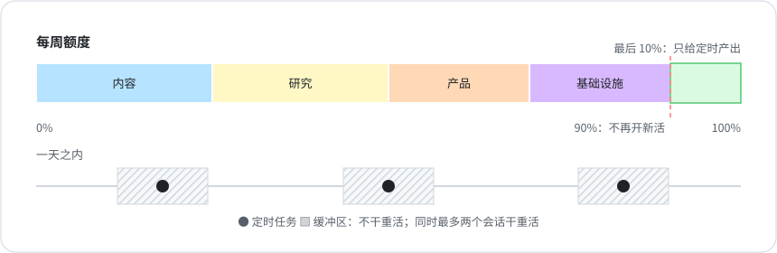

# 6 · 额度预算

[English](../06-quota-budget.md) · **中文**

2026 年 9 月 19 日到 22 日，几天高强度的开发把我的周额度烧光了。AI 定时任务一启动就因为额度报错失败，每天早上的简报停了四天。这是那个月第二次因为额度停摆（第一次见[第 4 章](04-one-judge-per-question.md)）。定时任务和开发会话用的是同一个池子，而没有任何东西护着定时任务。

第二天又来了个短期版本：九个会话同时干重活，半小时就把五小时额度从 25% 推到了 74%。

## 规矩

- 定时产出优先。周额度到 90%，所有会话都不再开新活，最后 10% 只用来保定时任务。
- 每块业务有自己的周预算（[`templates/QUOTA-BUDGET.json`](../../templates/QUOTA-BUDGET.json)）。超了预算的那块不再开新活，等下周重置，或者总部批了追加再说。没有分块预算，一块业务就能把所有人拖停：10 月 21 日和 22 日两天，账号一共用掉 78 个点的周额度，其中 63 个点是同一块业务用的。
- 同时最多两个会话干重活。重活指子代理、整仓扫描、大改造。看结果、回消息不算。
- 每个定时任务前后留出缓冲，这段时间不干重活。
- 定时任务漏了，绝不自动补跑。报告没发出去，由人决定要不要晚点补发。自动补跑会在停摆期间越积越多，一恢复就把所有人刷屏。

## 怎么保证

预算文件只是数据，真正拦人的得放在 agent 的工具调用前钩子里：按会话的工作目录对应到业务块，拿这块的用量和预算比，超了就拦住改文件和开子代理。Claude Code 不会把账号用量交给钩子，所以得先有东西把它写进文件。我把最新读数存在一个文件里，读数超过六小时没更新，钩子就先拦一次。

如果你给「这是在保定时产出」开了放行口子，让它几个小时内就过期。我的放行原来当天有效，结果一个会话写一句话，所有会话当天都能过闸。

## 之后怎么样

分块预算是 10 月 22 日上的。之后六天，对账脚本没报过一班没到。时间还太短，不能说已经解决了。
