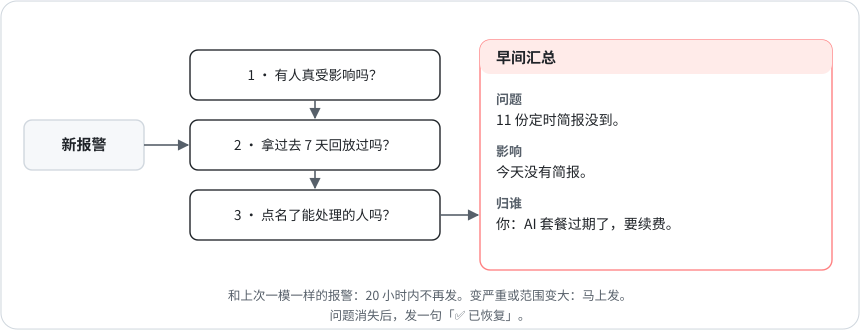

# 8 · 有记性的报警

[English](../08-alerts-that-remember.md) · **中文**

2026 年 10 月有一周，我自己的总部监控给我发了 28 条消息，大多是同几件内部超期的活，天天重发一遍，没有一条是我能处理的。9 月还出过一次更糟的：该提醒我的那个任务，和它要盯的东西跑在同一个账号上，额度一用完，我整整五天什么都没收到（见[第 4 章](04-one-judge-per-question.md)）。

## 报警上线之前

1. **它是不是意味着有人受影响？** 「报告没到」「数字过期了」「页面打不开」才算。日志里冒出一个错误不算。跟基线比，或者用比例，别拍脑袋定一个绝对阈值，那样总在不该响的时候响。
2. **拿过去 7 天回放一遍会怎样？** 数一数它会响几次，每次是不是真有人受影响。哪怕错一次，也先改规则再上线。
3. **谁能处理，具体该做什么？** 点名一个在被盯的东西挂掉时还能干活的人。如果原因可能是账号或者账单，那个人就是你，报警要写「去续费」，而不是「11 次产出没到」。读到它的人谁都处理不了，就别发进他们的群，记进负责人会处理的账里。

## 报警该怎么表现

- 只报变化。要发的内容和上次一模一样，20 小时内不再发。问题变严重或范围变大，马上发。
- 问题消失了，发一句「✅ 已恢复」，然后忘掉它。
- 去重用的键里不放会变的数字。键里要是有「3 小时前」，去重永远对不上。

每条红色报警都分三部分，按这个顺序：

- **问题：** 一句大白话，点名是哪个东西（哪份报告、哪个来源）。不写函数名、字段名、网址。
- **影响：** 读的人会碰到什么：没收到、数字过期了、在亏钱。
- **归谁：** 哪位负责人，或者总部，或者你。

## 目前的结果

那一周收了 28 条之后，内部欠账不再发给我，改记进总部处理的一本账。我每天的汇总，第一句就说清：什么没到，要不要我动手。

有一种情况直到 10 月 28 日才补上：很多任务同时停掉时，对账报警会猜是额度问题，然后把事派给总部，而总部跑在同一个账号上，也停了。现在一次核对里只要有 3 项以上 AI 跑的产出没到，报警就会请我去看 Claude 账号，写明要我做什么（套餐到期就续费；周额度用完了，等重置还是买加量由我定），归属第一个写我本人。零星缺几项，或者缺的都是不用 AI 账号的任务，照旧写「不用你动手」。拿 9 月 11 日到 10 月 28 日的 91 份核对表回放，新规则命中 35 份，旧规则误报过的两份不再报。从下一次核对起生效。
